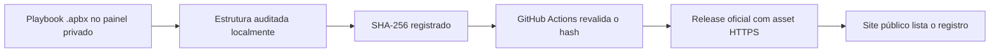

<div align="center">

# KT APBX

**Catálogo verificado de playbooks `.apbx` para o [KT WIRZADE](https://github.com/KT-TWEAKS/KT-WIRZADE).**

[](https://kt-tweaks-apbx.vercel.app) [](https://github.com/KT-TWEAKS/KT-WIRZADE) [](LICENSE)

[Abrir o catálogo](https://kt-tweaks-apbx.vercel.app) · [Instalar o painel](https://github.com/KT-TWEAKS/KT-WIRZADE/releases/latest) · [Termos e integridade](https://kt-tweaks-apbx.vercel.app/termos)

</div>

Cada playbook publicado no catálogo tem hash **SHA-256** registrado, é revalidado no GitHub Actions e é distribuído exclusivamente como asset HTTPS de uma GitHub Release. O painel KT WIRZADE lê o `catalog.json` e exibe nome, versão, hash e link de download de cada playbook.

## Como um playbook chega ao catálogo



- O painel privado recebe o arquivo, extrai e audita a estrutura localmente.
- O SHA-256 é calculado antes do registro e validado novamente no GitHub Actions.
- Cada APBX é publicado exclusivamente como asset de uma GitHub Release.
- Este repositório contém apenas o site Astro e `public/catalog.json`; nenhum APBX é incluído no deploy ou no histórico novo do catálogo.
- O site público mostra somente registros verificados com hash e download HTTPS.

## O que o site oferece

| Página | Descrição |
| --- | --- |
| [Catálogo](https://kt-tweaks-apbx.vercel.app/) | Lista de playbooks com busca e filtros |
| [Comparar](https://kt-tweaks-apbx.vercel.app/comparar) | Comparação lado a lado entre registros |
| [Changelog](https://kt-tweaks-apbx.vercel.app/changelog-playbooks) | Histórico público de alterações |
| [FAQ](https://kt-tweaks-apbx.vercel.app/faq) | Perguntas frequentes com busca |
| [Termos](https://kt-tweaks-apbx.vercel.app/termos) | Termos, integridade e limites de uso |

## Desenvolvimento

```bash
npm install
npm run dev
npm run build
```

O site de produção é servido pela Vercel em [kt-tweaks-apbx.vercel.app](https://kt-tweaks-apbx.vercel.app). O catálogo é atualizado automaticamente pelo workflow `publish-apbx.yml` depois que o painel conclui uma publicação.

## Estrutura

```text
src/layouts/                 shell e navegação
src/pages/index.astro        catálogo com busca e filtros
src/pages/comparar.astro     comparação lado a lado
src/pages/changelog-playbooks.astro
                             histórico público
src/pages/faq.astro          perguntas frequentes com busca
src/pages/termos.astro       termos públicos, integridade e limites
src/styles/site.css          identidade visual
public/catalog.json          metadados públicos, sem arquivos APBX
.github/workflows/           validação e publicação por Release
```

## Integridade

Nenhum arquivo `.apbx` é versionado neste repositório. Para conferir um pacote antes de aplicar no painel, compare o hash `SHA-256` exibido no catálogo com o calculado localmente no download — o painel também valida o hash no momento da seleção.
